# OlineIMS System Flowchart
## Online Inventory Management System

**System Overview:** A comprehensive web-based inventory management system for educational institutions with Laravel 11 backend and React 18 frontend.

---

## 🎯 Main System Architecture Flowchart

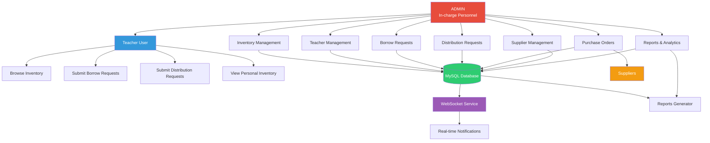

---

## 🔄 Authentication & Authorization Flow

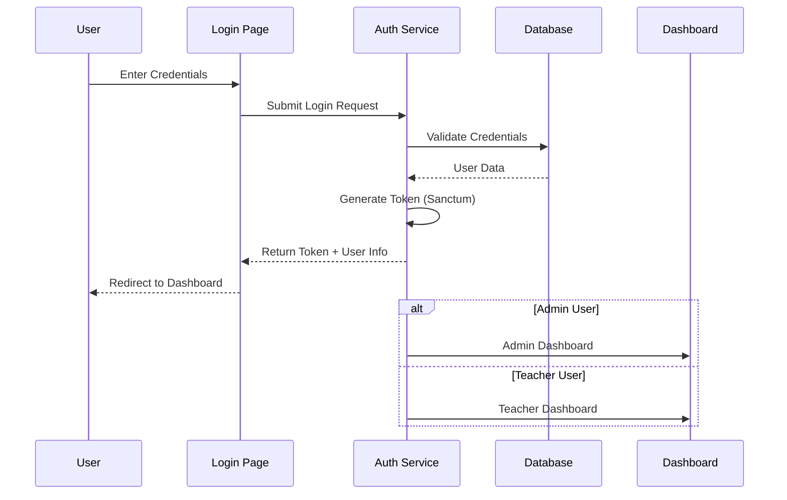

---

## 📦 Inventory Management Workflow

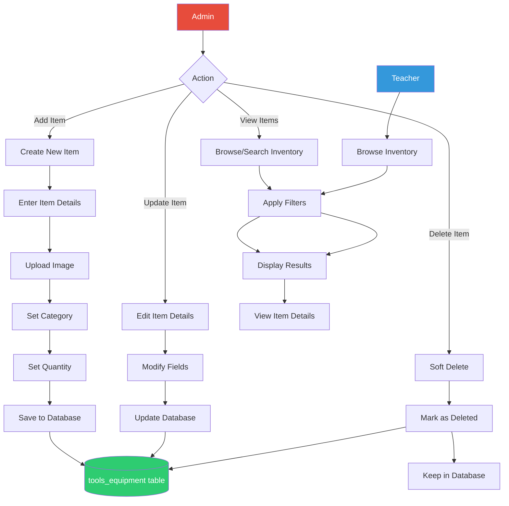

---

## 📋 Borrow Request Lifecycle

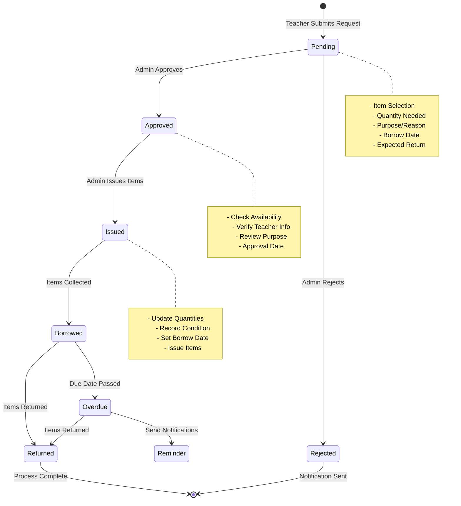

---

## 🚚 Distribution Request Process

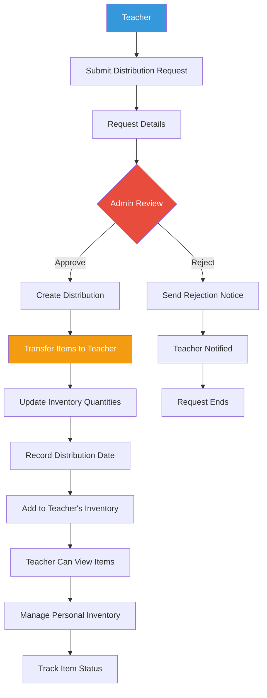

---

## 💳 Purchase Order Management

```mermaid
flowchart LR
    A[Admin] --> B[Create Purchase Order]
    B --> C[Select Supplier]
    C --> D[Add Items & Quantities]
    D --> E[Set Prices]
    E --> F[Calculate Totals]
    F --> G[DRAFT Status]
    
    G --> H[Submit for Approval]
    H --> I[PENDING Status]
    I --> J{Review & Approve}
    
    J -->|Approve| K[APPROVED Status]
    J -->|Reject| L[Back to Draft]
    
    K --> M[Send to Supplier]
    M --> N[Supplier Processes Order]
    N --> O[Items Delivered]
    O --> P[Admin Receives Items]
    P --> Q[Verify vs PO]
    Q --> R[Check Quantities]
    R --> S[Inspect Quality]
    S --> T[Mark as Received]
    T --> U[Add to Inventory]
    
    style A fill:#e74c3c,color:#fff
    style K fill:#2ecc71,color:#fff
    style N fill:#f39c12,color:#fff
    style U fill:#9b59b6,color:#fff
```

---

## 🔔 Notification System Flow

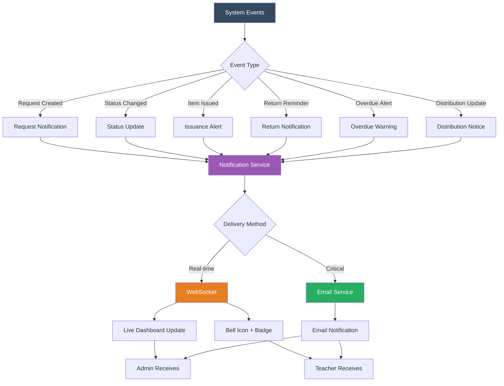

---

## 📊 Reporting & Analytics Flow

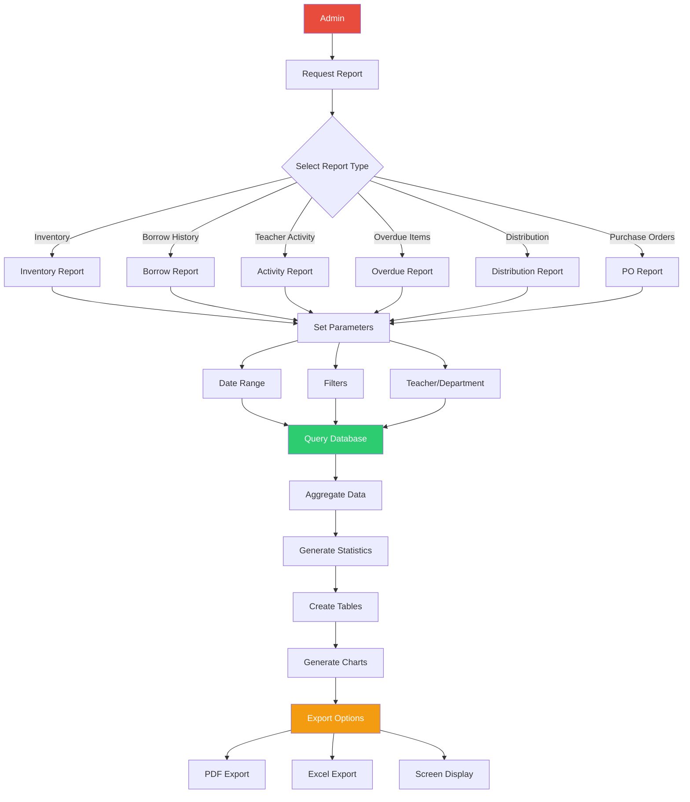

---

## 🗄️ Database Schema Relationships

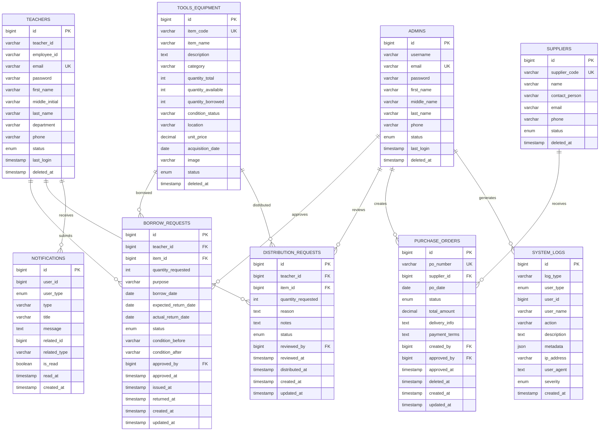

---

## 🔄 Complete System Workflow

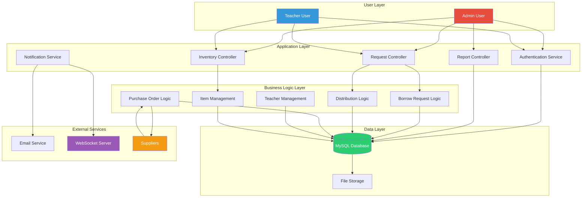

---

## 📱 Mobile Responsive Architecture

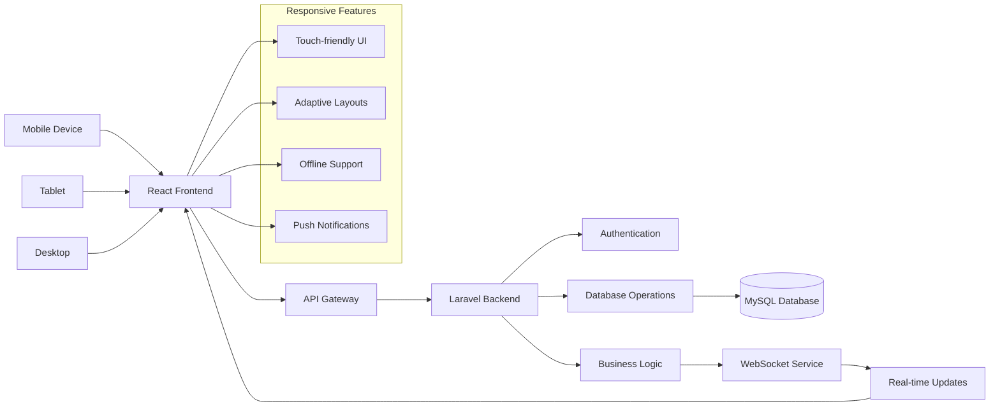

---

## 🚀 Deployment Architecture

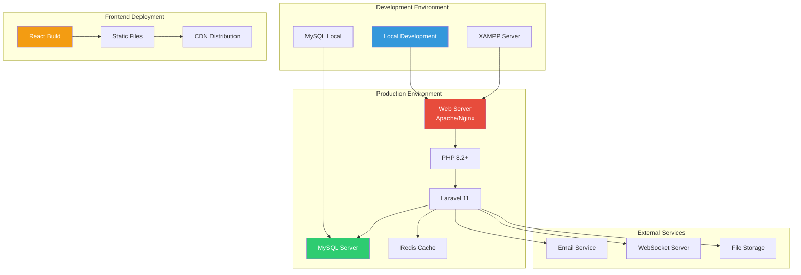

---

## 📈 Performance & Monitoring Flow

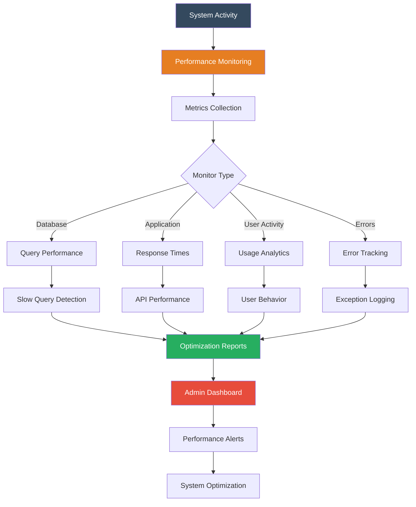

---

## 🔐 Security Architecture

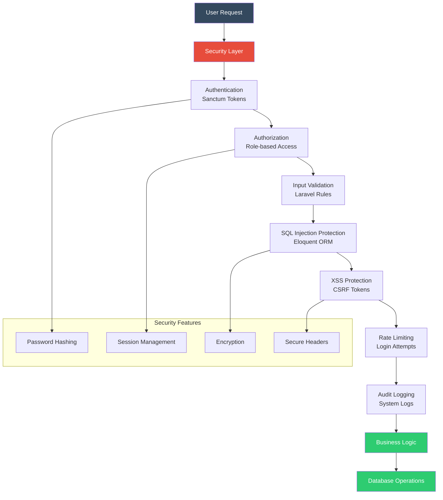

---

## 📋 Summary

This flowchart documentation provides a comprehensive visual representation of the OlineIMS system, covering:

1. **Main Architecture** - Overall system structure and components
2. **Authentication Flow** - User login and authorization process
3. **Inventory Management** - Item lifecycle and administration
4. **Request Workflows** - Borrow and distribution request processes
5. **Purchase Orders** - Procurement and supplier management
6. **Notification System** - Real-time alerts and communications
7. **Reporting** - Analytics and data visualization
8. **Database Schema** - Complete entity relationships
9. **System Workflow** - End-to-end process flow
10. **Mobile Architecture** - Responsive design considerations
11. **Deployment Structure** - Production environment setup
12. **Performance Monitoring** - System health and optimization
13. **Security Framework** - Protection mechanisms and compliance

The system is designed as a modern, scalable inventory management solution using Laravel 11 for the backend API and React 18 for the frontend, with real-time capabilities through WebSocket integration and comprehensive reporting features.
